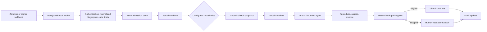

<div align="center">

# Issue Triage Agent

**Turn noisy issue signals into proven, reproducible engineering action.**

[](https://github.com/Blazity/issue-triage-agent/actions/workflows/ci.yml)
[](LICENSE)
[](https://github.com/Blazity/atlas)

[](https://vercel.com/new/clone?repository-url=https%3A%2F%2Fgithub.com%2FBlazity%2Fissue-triage-agent&env=DATABASE_URL%2CGITHUB_APP_ID%2CGITHUB_APP_PRIVATE_KEY%2CAI_GATEWAY_API_KEY%2CTRIAGE_MODEL%2CTRIAGE_ENABLED%2CAI_DATA_POLICY_ACKNOWLEDGED%2CCRON_SECRET%2CWEBHOOK_SECRET%2CZENDESK_WEBHOOK_SECRET)

</div>

Issue Triage Agent is a Vercel-first, open-source foundation for issue intake, repository investigation, and policy-gated pull requests. It authenticates incoming signals, groups repeat reports, routes each incident to configured GitHub repositories, and investigates every repository independently inside Vercel Sandbox. It opens a pull request only when a named reproduction check fails before the repair, passes afterward, and every deterministic safety gate approves the diff.

It never merges or deploys code.

[Watch a configured issue-triage workflow example →](https://www.youtube.com/watch?v=kyA0A_CUQrQ)

_The video shows a configured example. This repository provides the generic foundation; routing, severity policy, ownership, checks, and access rules must match your organization._

## 💡 Why it exists

| Without prepared triage             | With Issue Triage Agent                                       |
| ----------------------------------- | ------------------------------------------------------------- |
| An engineer starts with raw text    | A human receives a structured, evidence-backed verdict        |
| Repeat reports create parallel work | Exact deliveries and same-incident signals are deduplicated   |
| Repository ownership is guessed     | Explicit routes select configured owners and repositories     |
| A plausible fix can look verified   | A named check must fail before and pass after the repair      |
| Automation can drift into release   | The agent can prepare a PR; humans merge, release, and deploy |

## ✨ Features

- 📥 **Authenticated intake:** generic HMAC and Zendesk webhooks with freshness and replay protection.
- 🧹 **Duplicate reduction:** exact-delivery idempotency plus normalized same-incident fingerprints.
- 🗺️ **Explicit multi-repository routing:** one incident can produce independent outcomes and PRs across configured repositories.
- 🧪 **Isolated reproduction:** each repository runs inside its own ephemeral Vercel Sandbox.
- 🤖 **Time-bounded AI investigation:** policy-allowed files and configured checks, never arbitrary shell or network access.
- 🛡️ **Deterministic safety gates:** paths, reproduction, tests, concurrency, disclosure, and PR budgets stay in code.
- 🔀 **Review-ready pull requests:** a named check must fail before the repair and pass afterward.
- 💬 **Slack lifecycle updates:** one investigation message becomes the final evidence-backed summary.

## 🧾 What a reviewer gets

Every investigated repository returns a human-readable artifact:

- confirmed, likely false positive, or inconclusive verdict;
- severity and configured owner;
- reproduction steps;
- supporting and contradicting evidence;
- test results;
- recommended next human action;
- an independent PR link when a verified repair passes policy.

Unmapped, unclear, low-confidence, over-budget, or policy-blocked cases stop with an explicit human handoff.

## 🏗️ Architecture



The trusted control plane owns credentials, durable state, routing, policy, and GitHub writes. The sandbox receives source code and a bounded task, but no GitHub token. See [Architecture](docs/ARCHITECTURE.md) and [Threat model](docs/THREAT-MODEL.md).

## 🚀 Quick start

Requirements: Bun 1.3+, Node.js 20+, a Neon Postgres database, a GitHub App, and a Vercel project with Workflow and Sandbox available.

```bash
git clone https://github.com/Blazity/issue-triage-agent.git
cd issue-triage-agent
bun install
cp .env.example .env.local
bun run demo
```

`bun run demo` is a credential-free routing and orchestration smoke test. It does not call GitHub, Vercel Sandbox, or an AI model.

For the live path:

1. Copy the structure in `triage.config.example.ts` into `triage.config.ts`, set `configured: true`, and replace every example value.
2. Set the environment variables described in [Setup](docs/SETUP.md).
3. Run `bun run db:migrate`.
4. Deploy to Vercel.
5. Point a signed webhook or Zendesk webhook at the deployed endpoint.

The Deploy button deploys the application, but it cannot configure your GitHub App, repository policies, Zendesk webhook, or access rules. Those steps are intentionally explicit because every organization is different.

## Generic foundation vs. custom implementation

The repository deliberately separates reusable mechanics from organization-specific judgment.

| Included foundation                               | Configure or extend for your company                     |
| ------------------------------------------------- | -------------------------------------------------------- |
| Signed Zendesk and generic webhook intake         | Support-desk fields and escalation rules                 |
| Exact delivery and normalized-title deduplication | Observability adapters and semantic duplicate heuristics |
| Explicit multi-repository routing                 | Service ownership map and severity matrix                |
| Sandbox investigation and named checks            | Repository bootstrap and reproduction commands           |
| Verified PR preparation                           | Allowed paths, time limits, and approval policy          |
| Slack lifecycle message                           | Incident channel format and recipients                   |

Blazity implementations adapt this foundation to the tools, policies, and access model already used by the engineering team. The effect compounds as routing and policy improve; it is not a zero-configuration product.

## Configuration

Every repository has its own GitHub identity, bootstrap commands, verification checks, egress allowlist, and repair policy. The identity binds readable coordinates to the exact repository and GitHub App installation allowed to act on it.

### Connect GitHub repositories

Create one GitHub App, grant it **Contents: read and write**, **Pull requests: read and write**, and **Metadata: read**, then install it only on repositories the agent may investigate. The app installation is the connection. You do not add an agent package, webhook, or configuration file to target repositories.

For each configured repository:

- `owner` and `repository` are the readable GitHub coordinates, such as `acme-commerce/storefront`;
- `repositoryId` is GitHub's immutable numeric repository ID; and
- `installationId` is the numeric ID of the GitHub App installation that can access that repository.

Find the repository ID with `gh api repos/OWNER/REPOSITORY --jq .id`. Find the installation ID in the GitHub App installation URL or through the GitHub App installations API. Existing bootstrap and check commands must already work in the repository. See [Setup](docs/SETUP.md) for the complete permissions and environment configuration.

These are sample values; replace them before enabling production:

```ts
{
  key: "storefront",
  owner: "Checkout Experience",
  github: {
    owner: "acme-commerce",
    repository: "storefront",
    repositoryId: 100001,
    installationId: 200001,
    baseBranch: "main",
  },
  sandbox: {
    runtime: "node24",
    bootstrap: [["bun", "install", "--frozen-lockfile", "--ignore-scripts"]],
    checks: [["bun", "test"]],
    allowedEgress: ["registry.npmjs.org", "*.npmjs.org"],
  },
  policy: {
    pullRequestMode: "draft",
    allowedPaths: ["src/**", "tests/**"],
    allowPublicPullRequests: false,
    includeIssueContextInPullRequest: false,
    modelMetadataKeys: ["priority", "environment"],
  },
}
```

Routes are explicit. One signal may select multiple repositories; each repository produces its own isolated result and PR. A failure in one does not discard the others.

## Webhook input

Generic endpoint: `POST /api/webhooks/issue`

```json
{
  "eventId": "incident-123",
  "account": "production",
  "title": "Customers cannot complete checkout",
  "description": "Checkout attempts started failing after the latest release.",
  "route": "checkout",
  "occurredAt": "2026-01-01T00:00:00.000Z",
  "url": "https://status.example.com/incidents/123"
}
```

Send `x-triage-timestamp` and `x-triage-signature`. The signature is Base64 HMAC-SHA256 over `<timestamp>.<raw request body>` using `WEBHOOK_SECRET`. Requests older than five minutes are rejected.

Zendesk endpoint: `POST /api/webhooks/zendesk`. It accepts a normalized ticket payload and validates Zendesk's timestamp/signature format with `ZENDESK_WEBHOOK_SECRET`. See [Setup](docs/SETUP.md).

## 🛡️ Safety defaults

| Boundary                         | Default                      |
| -------------------------------- | ---------------------------- |
| GitHub credentials in Sandbox    | Never                        |
| Sandbox network after bootstrap  | Deny all                     |
| Model shell access               | None; configured checks only |
| Repositories per incident        | 3                            |
| Active runs                      | 3 globally, 1 per repository |
| Model steps per repository       | 4                            |
| Model steps per incident         | 20                           |
| Repository workflow deadline     | 10 minutes                   |
| GitHub and Slack request timeout | 30 seconds per request       |
| Patch attempts                   | 2                            |
| PRs per repository               | 3 per day                    |
| Merge or deploy authority        | None                         |
| Public-repository PRs            | Disabled                     |
| Source-ticket context in PRs     | Omitted                      |
| Inbound metadata sent to models  | Denied unless allowlisted    |

Blocked paths include CI configuration, environment files, lockfiles, package manifests, authentication code, migrations, and Terraform. Override policies deliberately; broader access increases risk.

## Supported in v0.1

- Runtime: Vercel, Next.js, Workflow, Sandbox, AI SDK, AI Gateway.
- State: Neon Postgres.
- Source adapters: generic HMAC webhook and Zendesk.
- Code host: GitHub App and GitHub pull requests.
- Notification: optional Slack lifecycle through Chat SDK's Slack adapter.
- Repository runtime: Node.js 24 sandbox.

Not included: automatic merge/deployment, GitLab, arbitrary model shell access, an admin dashboard, or observability-vendor-specific incident adapters.

Redacted issue text, explicitly allowlisted and redacted metadata, redacted contents of policy-allowed repository files, and redacted check evidence cross the AI Gateway/provider trust boundary during investigation. Every model request sets AI Gateway's `zeroDataRetention` and `disallowPromptTraining` routing controls. Enabling the live path also requires an explicit data-policy acknowledgement. Redaction is defense in depth, not a proof that arbitrary text contains no sensitive data; review provider retention, training, residency, and access terms before production use. External GitHub, Workflow, Sandbox, AI Gateway, Zendesk, and Slack behavior must be proven in your own staging environment; the repository test suite does not prove vendor credentials or policy.

## Development

```bash
bun run format
bun run lint
bun run typecheck
bun test
bun run build
```

See [Contributing](CONTRIBUTING.md), [Security](SECURITY.md), and the [Code of Conduct](CODE_OF_CONDUCT.md).

## 🧭 Built with Atlas Core

<p align="center">
  <a href="https://github.com/Blazity/atlas">
    <picture>
      <source media="(prefers-color-scheme: dark)" srcset="docs/assets/atlas-logo-dark.svg">
      
    </picture>
  </a>
</p>

[Atlas Core](https://github.com/Blazity/atlas) gives coding agents one repo-owned source of truth for architecture, vocabulary, decisions, memory, and safety rules. This repository includes a configured `.ai/` workspace, shared `AGENTS.md`, managed review skills, and deterministic `atlas doctor` checks.

```bash
npx --yes @blazity-atlas/core@0.5.0 doctor
```

## License

MIT © Blazity
