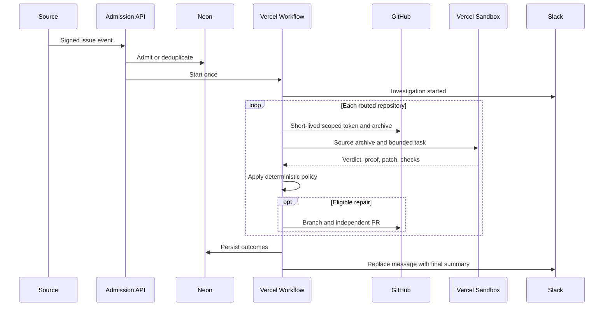

# Architecture

Issue Triage Agent separates a credentialed control plane from an untrusted execution plane.

## Control plane

The Next.js application and Vercel Workflow:

1. authenticate and normalize inbound signals;
2. persist exact-event and normalized-title deduplication, leases, budgets, and outcomes in Neon;
3. resolve explicit routes from the versioned configuration;
4. request repository-scoped GitHub App tokens;
5. download a bounded repository archive;
6. upload the archive to an isolated Vercel Sandbox;
7. produce a structured verdict with severity, owner, reproduction, proof, and next action;
8. require one named check to fail before and pass after the proposed repair;
9. evaluate the returned patch with deterministic policy;
10. create or reconcile a branch and pull request through GitHub's Git Data API; and
11. update the optional Slack notification.

The workflow snapshots the configuration version. It stops before repository work if the deployed version changes between admission and execution. One incident-level fencing token is acquired before repository fan-out, preventing duplicate workflows from splitting repository ownership. Repository work is split into retryable claim and immutable snapshot-resolution steps, a non-retrying investigation step, and retryable publication and completion steps. The immutable archive transfer gets bounded transient retries before model execution; the investigation step itself does not retry, so model budgets cannot multiply. Neon also assigns every physical repository run to one Workflow run with its own fencing token and deadline.

## Execution plane

Each repository gets a separate Vercel Sandbox. Bootstrap commands are configured by the operator and execute before network access changes to deny-all. Bootstrap must not modify tracked repository files.

The AI SDK agent can:

- list bounded repository paths;
- read an eligible regular text file;
- write an eligible regular text file; and
- execute one of the repository's preconfigured verification checks by index.

It cannot invoke an arbitrary command, access GitHub credentials, call GitHub, or choose an egress destination. Final policy is deterministic and does not rely on model self-assessment alone.

Before AI Gateway receives data, issue text, allowlisted metadata, requested file contents, and check evidence pass through bounded redaction. Metadata is deny-by-default. Every agent request sets Gateway routing controls for zero data retention and no prompt training. Repository path policy remains the authorization boundary; redaction is an additional disclosure control.

## Incident lifecycle

Repository processing is failure-isolated. One failed repository becomes a failed outcome; other repositories continue.

## Durable state

Neon stores:

- normalized signals and seven-day expiry;
- exact delivery keys and hourly normalized-title incident keys;
- source rate-limit windows;
- expiring workflow-start claims;
- incident-level workflow ownership and fencing tokens;
- workflow-owned repository execution leases and fencing tokens;
- daily PR budget claims;
- workflow IDs and repository outcomes; and
- notification idempotency state.

If workflow creation fails before a run is returned, the start claim is released so delivery retry can recover. A claim abandoned across a process crash expires. This can create one canonical recovery Workflow run. It durably waits for the earlier incident lease, then receives one fresh bounded execution window. Incident and repository fencing plus publication reconciliation keep this path deliberately at-least-once safe without allowing unbounded recovery loops.

Raw GitHub archives and sandbox workspaces do not cross the investigation-step boundary. The verified repair candidate returned by that step is persisted in Vercel Workflow state so the publication step can retry deterministically. Restrict Workflow observability access and configure platform retention accordingly.

## Extending the template

Add a source by normalizing it to `IssueSignal` and authenticating before admission. Add a code host by preserving the same boundary: credentials stay in the control plane, repository execution stays isolated, and all writes remain deterministic and review-gated.
